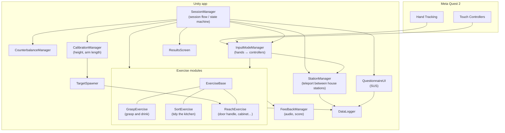

**Hands vs. Controllers in Upper-Limb Rehabilitation** — a Meta Quest 2 VR app that runs the same upper-limb rehabilitation exercises once with bare hands (hand tracking) and once with controllers, in counterbalanced order, and compares accuracy, movement smoothness, repetitions, SUS score and user preference.

The exercises are everyday activities in a virtual house: reaching for a door handle or a cabinet in the hallway, putting plates and glasses away in the kitchen, and picking up a glass of water to drink from it at the dining table. The user teleports between these stations.

📄 **Modules and user stories:** [main_modules.md](main_modules.md)

📄 **State of the Art document:** [Upper-limb rehab - State of The Art](https://docs.google.com/document/d/1BBVZG78lDgmgTwESydYuQSKIa57uikb0M7RVBRZt4mA/edit?usp=sharing)

**Team:** `Pirvan Ana-Maria` · `Leonte Luca` · `Zuzu Laura-Ioana` · `Tofan Anastasia Maria`

---

## Component diagram

## Main components

| Component | Responsibility |
| --- | --- |
| **SessionManager** | Drives the whole session: calibration → mode 1 (stations: hallway, kitchen, dining table) → mode 2 → preference → results → exit. Implemented as a simple state machine. |
| **CounterbalanceManager** | Assigns each participant to group A (hands first) or B (controllers first) so order effects cancel out. |
| **CalibrationManager** | Measures the participant's height and arm length at the start, so handles, cabinets and objects are placed at relative distances at every station. |
| **InputModeManager** | Switches between hand tracking and controllers at runtime by enabling/disabling the matching Meta XR Interaction SDK interactors. |
| **StationManager** | Holds the house stations (hallway, kitchen, dining table). Enables only the next station's teleport hotspot (Interaction SDK teleport: point + pinch with hands, thumbstick with controllers), fades during the jump, makes the user arrive facing the station, and supports automatic travel set by the therapist. Teleport time is logged separately and not counted as exercise time. |
| **ExerciseBase** | Shared logic for all exercises: start/stop, repetition counting, timing, sending events to the logger and feedback. |
| **GraspExercise** | Dining table: pick up everyday objects (glass of water, mug, bottle, fruit, tea box) and place them on a marked spot; the drinking task is done when the glass is held at the mouth for 1 s and put back on the coaster. |
| **SortExercise** | Kitchen: put plates, glasses, mugs and cutlery away in their usual places (plate rack, glass cabinet, shelf, cutlery pot), following the rule on the panel. |
| **ReachExercise** | Hallway and kitchen: touch everyday targets (door handle, light switch, drawer and wall-cabinet handles, shelf item) at three distances, five directions and two heights; uses **TargetSpawner** to position them from calibration data. |
| **FeedbackManager** | Sound and score on every successful repetition. |
| **QuestionnaireUI** | In-VR SUS questionnaire after each mode. |
| **DataLogger** | Records hand/controller position each frame and every exercise event (station, object, accuracy = distance to target, time per repetition, repetitions), teleport and tracking-loss events, plus SUS answers. |
| **ResultsScreen** | Shows a summary of both modes at the end of the session. |
| **Analysis scripts** (Python) | Compute movement smoothness (SPARC / normalized jerk) from trajectories and compare the two modes. |
