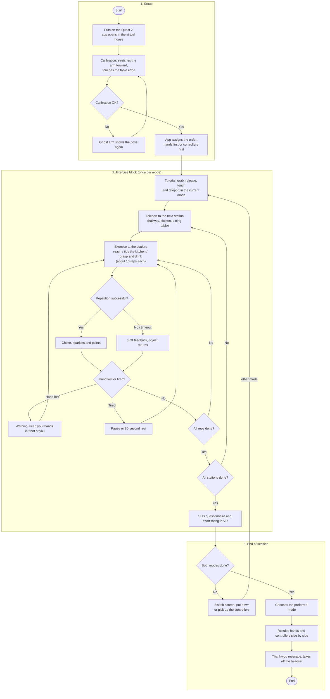

# Upper-limb rehab VR

A Meta Quest 2 app for upper-limb rehabilitation that runs the same everyday-life exercises in a virtual house, once with bare hands and once with controllers, and measures which input mode works better.

The exercises are daily activities rather than abstract tasks: reaching for a door handle or a cabinet, putting plates and glasses away in the kitchen, and picking up a glass of water to drink from it. The user moves between places in the house (hallway, kitchen, dining table) by teleporting.

---

## User Story Map

### 1. User: the patient

The user of our app is an adult doing upper-limb rehabilitation after a stroke, a fracture or hand or shoulder surgery, or, during our tests, a healthy volunteer. They sit at a table (or stand) wearing a Meta Quest 2, have little or no VR experience and may have weak grip strength, so every interaction must work with slow, simple movements.

- **Goal: start a session that is adapted to their body and abilities**
  - **Activity: set up the session before exercising**
    - Start the app in a calm, familiar-looking virtual house, with a short spoken welcome and a check that the image is clear and the headset fits
    - Choose seated or standing mode and the arm to train (left, right or both)
    - Calibrate height and arm length by stretching the arm forward for 3 seconds; at every station, objects (handles, cabinets, glasses) are then placed relative to this reach
  - **Activity: learn how to interact in the current mode**
    - Short tutorial for each mode: pinch and palm grab, release, poke and teleport with bare hands; grip button, trigger and thumbstick teleport with controllers
    - Highlight on objects that can be grabbed and a ghost hand that shows the correct gesture
    - One practice task that is not scored
  - **Activity: move around the house**
    - The house has one station per exercise: **hallway** (reaching), **kitchen** (sorting), **dining table** (grasping and drinking)
    - The user teleports to the next station by pointing at a glowing floor marker and confirming (pinch with hands, thumbstick/trigger with controllers); only the station markers are valid destinations
    - A short fade hides each teleport to avoid motion sickness, and the user always arrives facing the station
    - The therapist can switch on automatic travel instead: after each exercise the app fades out and moves the user to the next station by itself
- **Goal: do the rehabilitation exercises**
  - **Activity: grasp and drink (dining table)**
    - Everyday objects appear on the table one at a time: a glass of water, a mug and a bottle (cylinders), an apple or orange (ball), a small box of tea (cube), in three sizes
    - For the drinking task the user picks up the glass of water, brings it to the mouth and holds it there for 1 second (a sip sound plays and the water level drops), then puts it back on the coaster; the object snaps into place when it is close enough
    - For the other objects the user picks them up and places them on a marked spot (plate, coaster, fruit bowl)
    - Difficulty levels change the object size, the distance to the marked spot and the number of repetitions
  - **Activity: tidy the kitchen (kitchen)**
    - Plates, glasses, mugs and cutlery are on the kitchen counter; each one goes to its usual place: plates in the plate rack, glasses in the glass cabinet, mugs on the shelf, cutlery in the cutlery pot
    - A panel shows the current rule (for example "Put the glasses in the upper cabinet"); difficulty changes how high and how far the destinations are
    - A wrong placement gives soft feedback and the object returns to the counter
  - **Activity: reach everyday targets (hallway and kitchen)**
    - Targets are real objects in the house: a door handle, a light switch, a drawer handle, a kitchen wall-cabinet handle and an item on a shelf
    - Together they cover three distances (near, medium, arm's length), five directions and table or shoulder height, all scaled to the calibrated reach
    - The target is touched with the index fingertip (hands) or the controller tip; it lights up, plays a sound and reacts (the door opens slightly, the light turns on, the cabinet door swings open)
    - A target stays active for at most 10 seconds, then counts as missed
  - **Activity: get feedback**
    - Sound, effects and points on every successful repetition, plus a progress bar for the current exercise
    - A pause button and an automatic 30-second rest between exercises; the user can ask for a longer break
    - A warning when hand tracking is lost (hands out of view or overlapping), with a reminder to keep the hands in front of the headset
- **Goal: try both input modes and say which one they prefer**
  - **Activity: switch to the second mode**
    - After the first block the app asks the user to pick up or put down the controllers and switches mode without restarting
    - The second block repeats the same three exercises, at the same stations, with the same object positions and number of repetitions
  - **Activity: give their opinion**
    - SUS questionnaire (10 items, 5-point scale) after each mode, one item per screen, with large buttons pressed with a finger or the controller
    - Final question: which mode they prefer (hands, controllers or no preference)
  - **Activity: see their results**
    - Results screen comparing the two modes side by side: successful repetitions, average time, accuracy and SUS score

### 2. User: the therapist (session operator)

The second user is the team member or physiotherapist who runs the session. They prepare the headset, enter the participant's data, watch the session on a laptop or phone and analyse the results afterwards. Sessions must be identical across participants so the comparison is fair.

- **Goal: run a correct and comparable session**
  - **Activity: configure the session**
    - Enter the participant ID and basic data: age group, dominant hand, affected arm, previous VR experience
    - Automatic mode order: odd IDs start with hands, even IDs with controllers, with a manual override
    - Choose the exercises included and the number of repetitions for each (10 by default)
    - Choose how the user moves between stations: teleport by themselves (default) or automatic travel
- **Goal: collect reliable data and compare the two modes**
  - **Activity: log data automatically**
    - For every repetition: participant ID, mode, station, exercise, object or target, target position, start and end time, success or miss, final distance to the target
    - Hand or controller position recorded every frame for trajectory and smoothness analysis
    - Tracking events: moments when hand tracking confidence is low or the hand is lost, so those repetitions can be marked
    - Teleport events (time, from and to station, number of attempts); time spent teleporting is not counted in exercise time
    - SUS answers, effort rating and preference saved with the session
  - **Activity: export and analyse the results**
    - One CSV file per session, with the participant ID and date in the file name
    - Script that computes SUS scores, movement smoothness, success rate and time per repetition for each mode

---

## Journey Map

### Patient

### Therapist

```mermaid
flowchart LR
    T0([Start]) --> T1["Enters participant ID<br/>and basic data"]
    T1 --> T2["App picks the order:<br/>odd ID = hands first,<br/>even ID = controllers first"]
    T2 --> T3{Change order?}
    T3 -- Yes --> T4["Sets the order manually"] --> T5
    T3 -- No --> T5["Chooses exercises, repetitions (10 by default)<br/>and teleport or automatic travel"]
    T5 --> T6["Participant plays;<br/>app logs every repetition by itself"]
    T6 --> T7["Exports one CSV<br/>(participant ID + date)"]
    T7 --> T8["Script calculates SUS, smoothness,<br/>success rate, time per repetition"]
    T8 --> T9["Compares hands vs controllers"] --> T10([End])
```

---

## Wireframing / Storyboarding

The hand-drawn storyboard is in [`main_modules.pdf`](main_modules.pdf) (page 5). It shows the earlier abstract version of the exercises (colour sorting, disc targets, shape grasping) and needs to be redrawn for the house scenes: the hallway with the door handle, the kitchen with plates and glasses, and the dining table with the glass of water.

---

## Planning Asset Creation

### 3D

- Virtual house: hallway, kitchen and dining area built from the **Low Poly Interiors (Free)** pack already in the project (`Assets/LowPolyInteriorsFree`: walls, doors and door handles, windows, kitchen units and wall cabinets, dining table, shelves)
- Kitchenware from the same pack: dinner plates, wine glass, mug, cutlery pot, fork, storage jars
- Objects not in the pack (modelled in Blender): drinking glass with an animated water level, coaster, plate rack, light switch, small tea box, fruit (apple, orange)
- Teleport station markers on the floor: glowing circle with an arrow showing the facing direction
- Placement markers on the table and counter for the grasping and sorting exercises
- Decorative props (AI generated with Meshy, cleaned up in Blender: https://www.meshy.ai/)

### Graphics & 2D

- Instruction panel, score and timer panel, progress bar
- Rule panel for the kitchen task ("Put the glasses in the upper cabinet")
- SUS questionnaire screen, one item per page with five large answer buttons (own design)
- Results screen with hands and controllers side by side (own design)
- Calibration illustration: a person stretching the arm forward (AI generated, simple line style)
- Icons for hand, controller, pause, play, check, rest, teleport and settings (https://fonts.google.com/icons)

### Sounds

- Calm background music, looped at low volume
- Success chime on each correct repetition
- Soft sound for a wrong place or a missed target
- Everyday sounds: door handle click, light switch, cabinet door, plate and glass placed on a shelf, a sip of water
- Object pickup and drop on the table
- Teleport whoosh
- Short jingle at the end of each exercise and of the session (Kenney Music Jingles, CC0: https://kenney.nl/assets/music-jingles)
- Spoken instructions for the welcome, calibration, tutorial, teleporting, mode switch and SUS items (generated with ElevenLabs text to speech: https://elevenlabs.io/)

### VFX

- Star burst particles on every successful repetition
- Outline on grabbable objects and reachable targets when the hand or controller gets close (Quick Outline: https://assetstore.unity.com/packages/tools/particles-effects/quick-outline-115488)
- Fade to black during teleports

### Other assets

- Meta XR All-in-One SDK (Core SDK, Interaction SDK, Building Blocks): https://assetstore.unity.com/packages/tools/integration/meta-xr-all-in-one-sdk-269657
- Interaction SDK documentation (grab, poke, teleport, hand and controller interactors): https://developers.meta.com/horizon/documentation/unity/unity-isdk-interaction-sdk-overview/
- SUS questionnaire items and scoring
